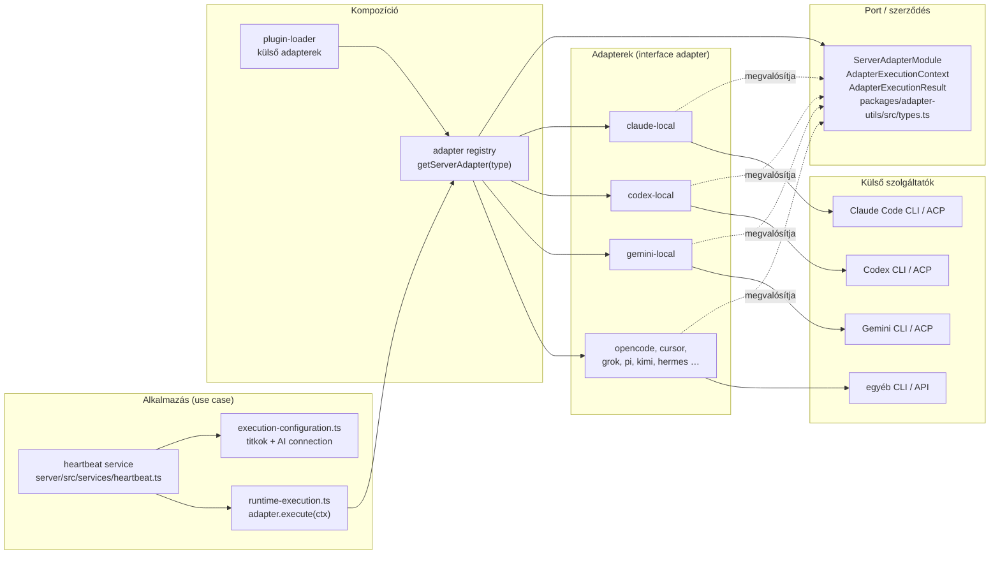
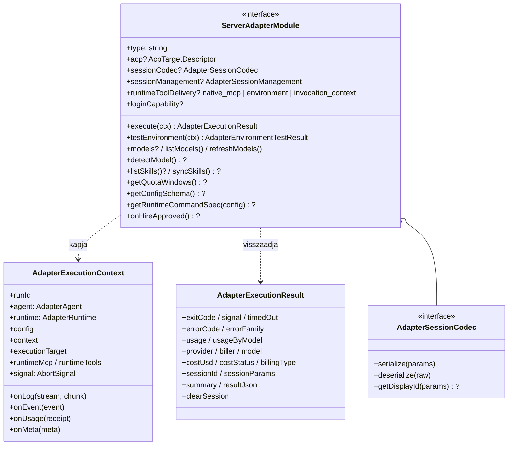
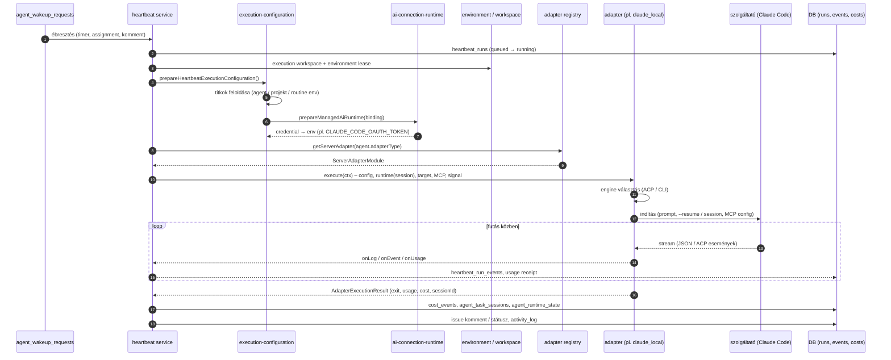
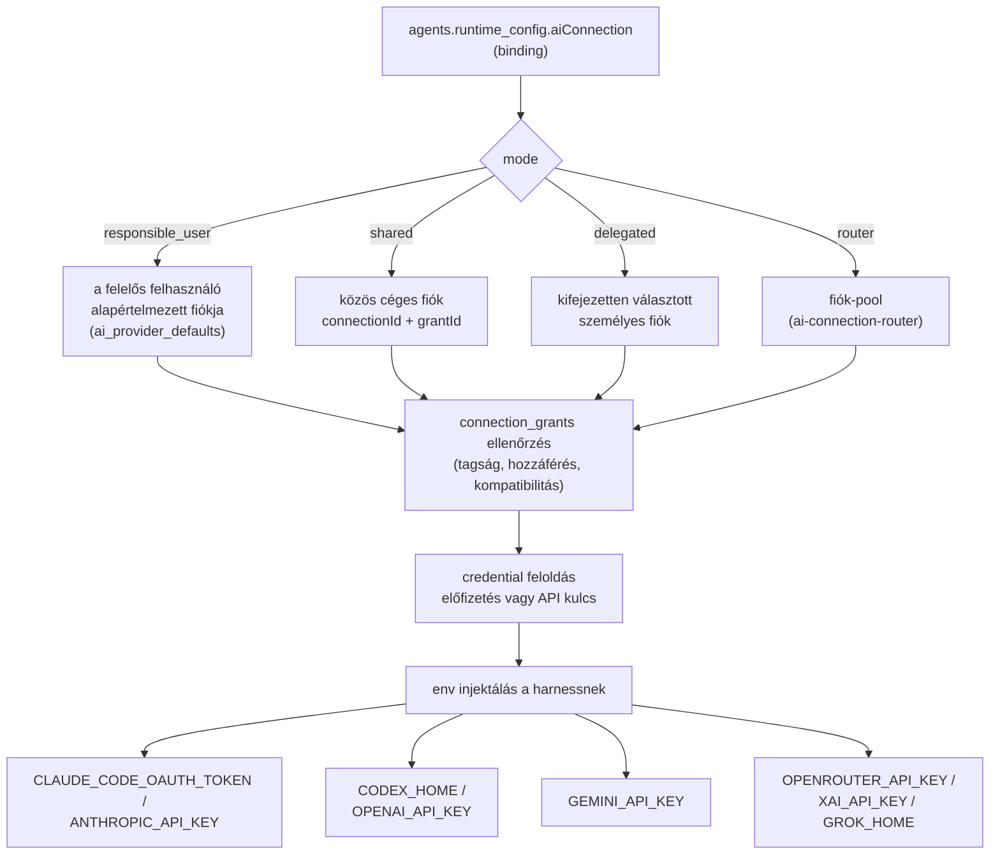

# AI szolgáltatók használata a Paperclipben

Állapot: tanulási / feltérképező anyag (nem normatív)
Forrás: a `packages/adapters/*`, `packages/adapter-utils`, `server/src/adapters` és
`server/src/services` kódja, 2026-10-24
Kapcsolódó: [Adatbázis ER-áttekintés](./database-er-overview.md)

## 1. Röviden

A Paperclip **control plane**: ő tartja nyilván a cégeket, ágenseket, feladatokat, költségkeretet és
jóváhagyásokat. Maga a munka (kódírás, elemzés) egy **AI szolgáltatónál** történik: Claude Code,
Codex, Gemini CLI, OpenCode, Cursor, Grok, Pi stb. A kettőt az **adapter** köti össze. Az adapter
egy kis modul, ami tudja, hogyan kell az adott szolgáltatót elindítani, hogyan kell a kimenetét
olvasni, és hogyan kell az eredményt egységes formában visszaadni.

A rendszer azért gördülékeny, mert a szerver **egyetlen interfészt** ismer
(`ServerAdapterModule`). Minden szolgáltató ezt valósítja meg. Ezért a heartbeat-motor nem tudja és
nem is kell tudnia, hogy éppen Claude vagy Codex dolgozik. A hitelesítést, a futtatási
környezetet, a session-folytatást és a költségmérést a szerver központilag intézi, az adapter
csak a szolgáltató-specifikus részt végzi.

## 2. Fogalomtár

| Fogalom | Jelentés | Hol él |
|---|---|---|
| **Adapter** | Egy szolgáltató „illesztője”: indítás, kimenet-parszolás, környezetteszt | `packages/adapters/<név>/` |
| `adapterType` | Az adapter típuskulcsa az ágensen, pl. `claude_local` | `agents.adapter_type` |
| `adapterConfig` | Az adapter beállításai: modell, cwd, engine, env, timeout … | `agents.adapter_config` (jsonb) |
| **Harness** | A tényleges ágens-futtató program (Claude Code CLI, Codex CLI …) | `aiRoutingHarness()` – `packages/shared/src/ai-provider-routing.ts` |
| **Engine** | A harness meghajtási módja: `acp` (Agent Client Protocol, strukturált) vagy `cli` (stdout-parszolás) | `adapterConfig.engine` |
| **Execution target** | Hol fut a harness: `local`, SSH vagy sandbox | `packages/adapter-utils/src/execution-target.ts` |
| **Environment** | Instance-szintű futtatókörnyezet: `local`, `ssh`, `sandbox`, `plugin` driver | `environments` tábla, `ENVIRONMENT_DRIVERS` |
| **AI connection** | Elmentett szolgáltatói fiók (előfizetés vagy API kulcs) a cég Apps/Connections részén | `tool_connections` (`connection_purpose = "ai"`) |
| **Grant** | Ki használhatja az AI connectiont (felhasználó vagy ágens) | `connection_grants` |
| **Session** | A szolgáltató beszélgetés-azonosítója, amit a következő heartbeat folytat | `agent_task_sessions`, `agent_runtime_state` |
| **Heartbeat run** | Egy ágens egy ébredése és futása | `heartbeat_runs` |

## 3. Szolgáltató-térkép

A beépített adapterek a `server/src/adapters/registry.ts` `registerBuiltInAdapters()` függvényében
regisztrálódnak, a típuskulcsok listája a `server/src/adapters/builtin-adapter-types.ts` fájlban van.

| Típuskulcs | Szolgáltató / harness | Indított program (npm csomag) | Engine | Eszköz-átadás¹ | Megjegyzés |
|---|---|---|---|---|---|
| `claude_local` | Anthropic **Claude Code** | `claude` (`@anthropic-ai/claude-code`) | ACP (alapértelmezett) vagy CLI | `native_mcp` | előfizetés vagy API kulcs, kvóta-lekérdezés, böngészős login |
| `codex_local` | OpenAI **Codex** | `codex` (`@openai/codex`), CLI módban `codex exec --json` | ACP (alapértelmezett) vagy CLI | `native_mcp` | ChatGPT/Codex előfizetés vagy API kulcs, kvóta, login |
| `gemini_local` | Google **Gemini CLI** | `gemini` (`@google/gemini-cli`) | ACP (alapértelmezett) vagy CLI | `environment` | API kulcs (`GEMINI_API_KEY`), `--resume` |
| `kimi_local` | Moonshot **Kimi Code** | `kimi` (`@moonshot-ai/kimi-code`) | ACP (alapértelmezett) vagy CLI | `environment` | |
| `opencode_local` | **OpenCode** (több szolgáltató) | `opencode` (`opencode-ai`) | CLI | `environment` | `provider/model` formátum, OpenRouter |
| `pi_local` | **Pi** coding agent | `pi` (`@mariozechner/pi-coding-agent`) | CLI | `environment` | modell: `openai/…`, `anthropic/…`, `google/…`, `openrouter/…` |
| `grok_local` | xAI **Grok** | `grok` (konfigurálható parancs) | CLI | `environment` | előfizetés vagy `XAI_API_KEY`, login |
| `cursor` | **Cursor** CLI | `agent` (konfigurálható parancs) | CLI | `environment` | háttér-módú futás, `--resume` |
| `cursor_cloud` | **Cursor Cloud** agents | felhő API | – | `invocation_context` | nincs helyi folyamat |
| `hermes_local` | **Hermes** CLI | `@paperclipai/hermes-paperclip-adapter` | CLI | `environment` | |
| `hermes_gateway` | **Hermes** API szerver | ugyanaz a csomag, `/gateway` | HTTP/SSE | `invocation_context` | már futó szolgáltatást hív |
| `openclaw_gateway` | **OpenClaw** gateway | HTTP | – | `invocation_context` | |
| `process` | Tetszőleges shell parancs | – | – | – | nincs strukturált átirat |
| `http` | Külső webhook | – | – | – | |
| `paperclip_runner` | **Natív Paperclip Runner** (kísérleti): Codex, OpenCode, Claude Managed, AWS AgentCore, ACPX profilok | `paperclip-runnerd` | PRP v1 | `environment` | instance flag kapcsolja be (8. fejezet) |
| `acpx_local` | *visszavont* | – | – | – | helyette `claude_local` / `codex_local` + `engine: "acp"` |

¹ `runtimeToolDelivery`: hogyan kapja meg a harness a Paperclip eszközeit (MCP szervereket).
`native_mcp`: a harness saját MCP-konfigurációjába kerülnek. `environment`: környezeti változókon
keresztül. `invocation_context`: a hívás kontextusában, távoli szolgáltatásnak.

**Plugin-adapterek.** Külső npm csomagként is lehet adaptert telepíteni (pl. `droid_local` – Factory
Droid). Ezek a `server/src/adapters/plugin-loader.ts`-en keresztül, induláskor vagy a
`POST /api/adapters` hívásra töltődnek be. Beépített típust nem írhatnak felül csendben.

## 4. Architektúra – Clean Architecture nézet

A függőségek egy irányba mutatnak: a heartbeat-motor (use case) csak a szerződést ismeri, a
konkrét szolgáltatót nem. A szerződés a `packages/adapter-utils` csomagban van, amitől a szerver és
az adapterek is függenek. Ez a **Dependency Inversion** elve.

### A szerződés (port)

Kötelező és opcionális képességek (`packages/adapter-utils/src/types.ts`, `ServerAdapterModule`):

### SOLID-leképezés

| Elv | Hogyan jelenik meg |
|---|---|
| **SRP** – egy felelősség | Az adapter-csomag felelősségenként bontott: `server/execute.ts` (futtatás), `server/parse.ts` (kimenet), `server/test.ts` (`testEnvironment`, diagnosztika), `server/models.ts` (modellek, ahol van), `ui/` (átirat-megjelenítés), `cli/format-event.ts` (terminál). |
| **OCP** – bővíthető, módosítás nélkül | Új szolgáltató = új modul + regisztráció (`registerBuiltInAdapters` vagy plugin). A heartbeat-motor kódja nem változik. |
| **LSP** – helyettesíthetőség | Minden adapter ugyanazt az `AdapterExecutionResult`-ot adja vissza (exit, usage, költség, session). Ezért a futás lezárása (`heartbeat/run-completion.ts`) szolgáltatótól függetlenül működik. |
| **ISP** – szűk interfészek | A ritka képességek opcionálisak (`?`): kvóta, login, skill-szinkron, ACP. A `process` és `http` adapternek ezeket nem kell megvalósítania. |
| **DIP** – absztrakciótól függés | A szerver a `@paperclipai/adapter-utils` típusaitól függ (`server/src/adapters/types.ts` csak re-exportálja őket), nem az adapter-csomagoktól. |

## 5. Egy futás életútja

A lépések kódban:

1. **Ütemezés és állapot.** `server/src/services/heartbeat.ts` és a `heartbeat/` almappa
   (`queue.ts`, `scheduling.ts`, `run-state.ts`).
2. **Munkaterület és környezet.** `heartbeat/workspace-preparation.ts`,
   `heartbeat/environment-selection.ts`. Az execution target `local`, SSH vagy sandbox lehet.
   Távoli futásnál az `adapter-utils` szinkronizálja oda és vissza a munkakönyvtárat
   (lásd `packages/adapters/AUTHORING.md`: „no-remote-git” szabály).
3. **Konfiguráció és hitelesítés.** `heartbeat/execution-configuration.ts`, majd
   `ai-connection-runtime.ts` → `prepareManagedAiRuntime()` (6.4 fejezet).
4. **Adapter kiválasztása.** `getServerAdapter(agent.adapterType)` (`heartbeat.ts`).
   A szerver itt dönti el azt is, hogy direkt adapter vagy natív runner fut-e
   (`resolveHeartbeatNativeRuntimeMode`).
5. **Végrehajtás.** `heartbeat/runtime-execution.ts`: `adapter.execute({...})`. A kontextusban
   megy át a session (`runtime`), a futtatási célpont, a Paperclip MCP szerverek
   (`runtimeMcp`, `runtimeTools`), a megszakító jel (`signal`) és a visszahívások.
6. **Lezárás.** `heartbeat/run-completion.ts`: a session mentése a `sessionCodec`-kel, a
   költség rögzítése (`services/usage-receipts.ts` → `services/costs.ts` → `cost_events`), a
   kimenet kommentként vagy munkatermékként megjelenik, és activity log bejegyzés keletkezik.

## 6. Mitől gördülékeny? – a kulcsmechanizmusok

### 6.1 Egységes szerződés

Minden szolgáltató ugyanazt kapja (`AdapterExecutionContext`) és ugyanazt adja vissza
(`AdapterExecutionResult`). A futás többi része (költség, session, komment, státusz, újrapróbálás)
ezért **egyszer van megírva**, nem szolgáltatónként.

### 6.2 Session-folytatás (az ágens „emlékszik”)

- A szolgáltató session-azonosítóját az adapter a resultban adja vissza (`sessionId`,
  `sessionParams`). A szerver a `sessionCodec.serialize()`-zal elmenti
  (`agent_task_sessions`, feladatonként: `task_key`).
- A következő heartbeatnél a `deserialize()` után a `runtime` mezőben kapja vissza, és az adapter
  folytatja: Claude/Gemini/Cursor `--resume`, OpenCode `--session`, Codex/ACP saját session.
- **Biztonsági háló:** ha a munkakönyvtár megváltozott, vagy a resume „ismeretlen session” hibát ad,
  az adapter friss sessiont indít (pl. `docs/adapters/gemini-local.md`). A `clearSession: true`
  eredmény törli a mentett sessiont. A `sessionManagement` a hosszú sessionök tömörítési
  szabályát írja le.

### 6.3 Engine: ACP vagy CLI

- `claude_local`, `codex_local`, `gemini_local`, `kimi_local`: az `adapterConfig.engine`
  **alapértéke `acp`** (`normalizeEngine` az adapterek `server/acp.ts` fájljában). Az ACP
  strukturált eseményfolyamot ad (`acpx.session`, `acpx.status`, `acpx.text_delta`,
  `acpx.tool_call`, `acpx.result`, `acpx.error`), ezért a UI élőben mutatja a gondolkodást és az
  eszközhívásokat.
- Ha az ACP előfeltétele hiányzik (Node ≥ 24.11, `@agentclientprotocol/*-acp` csomag), vagy helyi
  fájlrendszer-/hálózat-korlátozás van beállítva, az adapter **nem vált csendben**. Ehelyett
  `adapter_engine_unavailable` hibát ad, és megmondja a javítást: `engine=cli`. Ez szándékos clean
  code döntés: a futás jogosultsági szerződése nem változhat attól, hogy mi van telepítve.
- A `cli` engine a szolgáltató saját streaming JSON kimenetét parszolja
  (`claude --print --output-format stream-json`, `codex exec --json`,
  `gemini --output-format stream-json`).

### 6.4 Hitelesítés: AI connections

A szerver központilag dönti el, melyik fiókkal fut az ágens, és a credentialt a megfelelő
környezeti változóba teszi. Az adapternek ehhez nem kell tudnia semmit a fiókokról.

Kompatibilitási mátrix (`AI_CONNECTION_CAPABILITIES`, `packages/shared/src/ai-connections.ts`):

| Szolgáltató | Előfizetés (env kulcs → adapter) | API kulcs (env kulcs → adapter) |
|---|---|---|
| Anthropic / Claude | `CLAUDE_CODE_OAUTH_TOKEN` → `claude_local` | `ANTHROPIC_API_KEY` → `claude_local`, `pi_local` |
| OpenAI | `CODEX_HOME` → `codex_local` | `OPENAI_API_KEY` → `codex_local`, `pi_local` |
| Google | – | `GEMINI_API_KEY` → `gemini_local`, `pi_local` |
| OpenRouter | – | `OPENROUTER_API_KEY` → `opencode_local`, `pi_local` (`openrouter/` modell) |
| xAI / Grok | `GROK_HOME` → `grok_local` | `XAI_API_KEY` → `grok_local` |
| GitHub Copilot | – | `COPILOT_GITHUB_TOKEN` → `copilot_runtime` (natív runner ACPX profil) |

Fontos garanciák:

- **Izoláció.** Ha AI connection van kötve, a szerver a projekt-, routine- és környezeti env-ből
  kiszűri az auth-kulcsokat (`stripAiAuthBindings`, `AI_AUTH_ENV_KEYS`). Így nem keveredhet két
  fiók. Az ütköző routing-beállításokat (pl. `ANTHROPIC_BASE_URL`) a `prepareManagedAiRuntime`
  elutasítja.
- **Kompatibilitás-ellenőrzés futás előtt.** Az `isAiConnectionCompatible()` megnézi, hogy a fiók
  és a harness összeillik-e. Ha nem, a hiba oka egy beszédes kód
  (`AiConnectionUnavailableReason`: `membership_missing`, `incompatible`, `credential_missing` …).
- **Foglalt fiók.** Ha a fiók éppen foglalt, a futás nem bukik el, hanem halasztott újrapróbálásra
  kerül (`isAiConnectionBusy` → `finalizeAiConnectionBusyDeferral`). Router poolnál
  `AiConnectionPoolExhausted` jelzi, mikor szabadul fel kvóta.
- **Hiányzó fiók.** A szerver *connection intent*-et küld a felelős felhasználónak, hogy kösse be a
  fiókot (`connectionIntentService(db).request(...)`).

### 6.5 Futtatási célpont és credential-topológia

Ugyanaz az adapter futhat a Paperclip gépén, SSH-n vagy menedzselt sandboxban
(`AdapterExecutionTarget = local | ssh | sandbox`). Az adapter dönti el, melyik credential a
mérvadó (`docs/adapters/overview.md`, „Credential ownership”):

- **Codex:** a host `auth.json` a menedzselt `CODEX_HOME`-ba kerül és feltöltődik, vagy egy
  ágensszintű `OPENAI_API_KEY` alapján API-kulcsos `auth.json` jön létre.
- **Claude:** a konfigurált `ANTHROPIC_API_KEY` / `CLAUDE_CODE_OAUTH_TOKEN` nyer. Ha nincs ilyen,
  a sandbox image saját bejelentkezése érvényes.

### 6.6 Modellek, skillek, környezetteszt

- **Modellek:** statikus `models`, dinamikus `listModels()` / `refreshModels()`, felismerés
  `detectModel()`. A szerver oldali belépési pont a `listAdapterModels(type)` (registry).
- **Skillek:** a `syncSkills()` a Paperclip skilleket a harness saját skill-könyvtárába szinkronizálja
  (pl. `~/.gemini/skills`), a meglévő felhasználói skilleket nem írja felül.
- **Környezetteszt:** a UI „Test Environment” gombja a `testEnvironment()`-et hívja. Ez
  ellenőrzi a parancs elérhetőségét, a hitelesítést és a cwd-t, és `pass` / `warn` / `fail` szintű
  ellenőrzéseket ad vissza javítási tippel.

### 6.7 Költség és kvóta

- Az adapter futás közben `onUsage()`-szel részösszegeket küld, a végén pedig a resultban adja meg a
  tokeneket, a modellt, a `biller`-t, a `billingType`-ot és a `costUsd` / `costStatus` értéket
  (`reported` / `estimated` / `unpriced`).
- A szerver ebből idempotens `cost_events` sort ír. Ez táplálja a költségkeretet
  (`budget_policies`): túllépéskor az ágens automatikusan szünetel.
- A `getQuotaWindows()` (Claude, Codex) megmutatja az előfizetés használati ablakait. A céges
  szintű lekérdezés: `services/quota-windows.ts` → `fetchCompanyQuotaWindows`.

### 6.8 Megszakítás és hibakezelés

- A `ctx.signal` (`AbortSignal`) az operátori leállítást közvetíti. Az adapternek le kell zárnia a
  folyamatot, mielőtt visszatér.
- Az `errorFamily` osztályozza a hibát: `configuration`, `transient_upstream`, `provider_quota`,
  `model_refusal`, `refresh_token_*`. Ez alapján dönt a szerver az újrapróbálásról
  (`heartbeat/retries.ts`), és a `retryNotBefore` mező alapján időzít.
- Ha a hiba még a szolgáltató indítása előtt történt
  (`executionRecovery: { kind: "bootstrap", providerWorkStarted: false }`), az újrapróbálás
  biztonságos, mert nem keletkezett mellékhatás.

## 7. Szolgáltatónkénti jegyzetek

**Claude Code (`claude_local`)**
- Csomag: `@anthropic-ai/claude-code`, ACP-hez `@agentclientprotocol/claude-agent-acp`.
- CLI mód: `--print --output-format stream-json --verbose`, `--resume`, `--mcp-config` +
  `--strict-mcp-config`, `--model`, `--effort`, `--max-turns`.
- Auth: előfizetés (OAuth token) vagy API kulcs. A sandboxban az image bejelentkezése is használható.
- Extra: az ágens-azonosító fejlécet a `stampClaudeAgentIdHeader` teszi rá
  (`server/src/adapters/claude-agent-id-header.ts`).

**Codex (`codex_local`)**
- Csomag: `@openai/codex`, ACP-hez `@agentclientprotocol/codex-acp`.
- CLI mód: `codex exec --json … -` (a prompt stdin-en megy). A sandbox- és jóváhagyási mód
  konfigurálható (`sandbox_mode`, `approval_policy`).
- Auth: ChatGPT/Codex előfizetés (`CODEX_HOME`) vagy `OPENAI_API_KEY`. A modellek listája:
  `server/src/adapters/codex-models.ts`.

**Gemini CLI (`gemini_local`)**
- Csomag: `@google/gemini-cli`, ACP támogatással.
- CLI mód: `--prompt`, `--output-format stream-json`, `--resume`, `--model` (alapérték `auto`).
  Felügyelet nélküli futáshoz `--approval-mode yolo` (`yolo: true`).
- Auth: `GEMINI_API_KEY` / `GOOGLE_API_KEY` vagy a helyi Gemini CLI bejelentkezés.

**OpenCode (`opencode_local`)**
- Több szolgáltatót kezel `provider/model` formában, OpenRouteren keresztül is. Session: `--session`.
- Sandboxban egy OpenCode plugin úgy állítja be a shell-alfolyamatokat, hogy memóriahiánynál a
  kernel ezeket állítsa le először, ne az OpenCode-ot.

**Cursor (`cursor`, `cursor_cloud`)**
- Helyi: `--output-format`, `--resume`, `--workspace`, `--yolo`. A modellek listája:
  `server/src/adapters/cursor-models.ts`.
- Felhő: nincs helyi folyamat, a Cursor Cloud API-t hívja (`invocation_context`).

**Grok (`grok_local`), Pi (`pi_local`), Kimi (`kimi_local`)**
- Grok: saját login (`GROK_HOME`) vagy `XAI_API_KEY`. A skilleket fájlként kell megkapnia
  (`requiresMaterializedRuntimeSkills`).
- Pi: egy harness több szolgáltatóhoz. A modellnév előtagja határozza meg a szolgáltatót.
- Kimi: ACP az alapértelmezett, headless `-p` mód választható.

**Hermes, OpenClaw (gateway-ek)**
- `hermes_local` a helyi CLI-t indítja. `hermes_gateway` és `openclaw_gateway` egy már futó
  HTTP/SSE szolgáltatást hív.

**`process`, `http`**
- Általános kiskapuk: tetszőleges parancs vagy webhook. Nincs strukturált átirat, költség- és
  session-kezelés.

## 8. Direkt adapter vs. natív Paperclip Runner

| | Direkt adapter (alapértelmezett) | `paperclip_runner` (kísérleti) |
|---|---|---|
| Hol fut a szolgáltató-session | a Paperclip szerver indítja | külön `paperclip-runnerd` folyamat (Rust) |
| Protokoll | szolgáltató CLI / ACP | Paperclip Runner Protocol (PRP v1, WebSocket) |
| Újraindulás utáni helyreállítás | futás-szintű újrapróbálás | tartós kézbesítés, determinisztikus visszajátszás |
| Bekapcsolás | mindig elérhető | instance flag: `experimental.enableNativeRunner` |
| Szolgáltatók | mind a 3. fejezet szerint | minősített profilok: Codex, OpenCode, Claude Managed, AWS AgentCore, ACPX (Claude, Grok, Pi, Copilot) |

A döntés a `resolveHeartbeatNativeRuntimeMode()`-ban születik, és a futáson perzisztálódik, tehát
futás közben nem változik. Részletek: `doc/architecture/paperclip-runner.md`.

## 9. Új szolgáltató hozzáadása

1. **Csomag:** `packages/adapters/<név>-local/` a meglévők mintájára: `src/index.ts` (metaadat:
   típus, címke, modellek), `src/server/` (`execute.ts`, `parse.ts`, `test.ts`, opcionálisan `models.ts`),
   `src/ui/` (átirat-parser, konfigurációs űrlap), `src/cli/format-event.ts`.
2. **Szerződés:** valósítsd meg a `ServerAdapterModule`-t. Kötelező az `execute` és a
   `testEnvironment`. A többit akkor add hozzá, ha a szolgáltató tudja (session codec, modellek,
   skillek, kvóta, ACP).
3. **Regisztráció:** beépítettként a `server/src/adapters/registry.ts`
   `registerBuiltInAdapters()` listájába és a `BUILTIN_ADAPTER_TYPES` halmazba. Külső
   pluginként `createServerAdapter()` exporttal (`docs/adapters/external-adapters.md`).
4. **Hitelesítés:** ha AI connectiont is támogat, egészítsd ki az `AI_CONNECTION_CAPABILITIES`
   mátrixot és az auth env kulcsokat (`agent-ai-connection-default.ts`,
   `ai-connection-runtime.ts`). Szinkronban kell lennie a shared, server és UI rétegnek
   (`AGENTS.md` 5.2).
5. **Szabályok:** ne `git push`-olj a futásból, a munkakönyvtár az egyetlen perzisztencia-határ
   (`packages/adapters/AUTHORING.md`). Ne nyeld le a visszaszinkronizálási hibát. Ne válts csendben
   engine-t vagy jogosultsági módot.

**Clean code ellenőrzőlista**
- [ ] Az `execute()` csak orkesztrál; a parancsépítés, a parszolás és a hibaosztályozás külön,
      tesztelt függvényben van.
- [ ] Minden hiba beszédes `errorCode` és `errorFamily` mellett tér vissza, nem dob kezeletlen kivételt.
- [ ] A titkok soha nem kerülnek a logba (`log-redaction.ts`, `command-redaction.ts`).
- [ ] Az `AbortSignal` le van kezelve, a gyerekfolyamat a visszatérés előtt leáll.
- [ ] A usage és a költség a resultban szerepel (`costStatus` jelzi, ha csak becslés).
- [ ] Tesztek az adapter mellett (`*.test.ts`), a meglévő adapterek mintájára.

## 10. Kapcsolódás az adatmodellhez

| Tábla | Szerepe a szolgáltató-használatban |
|---|---|
| `agents` | `adapter_type`, `adapter_config`, `runtime_config` (benne az `aiConnection` binding), `default_environment_id` |
| `agent_runtime_state` | utolsó session, összesített tokenek és költség ágensenként |
| `agent_task_sessions` | feladatonkénti szolgáltatói session (resume) |
| `heartbeat_runs` / `heartbeat_run_events` | a futás és a részletes eseménynapló |
| `environments` / `environment_leases` | hol fut a harness |
| `tool_connections` (`connection_purpose = "ai"`) / `connection_grants` | AI fiókok és hozzáférés |
| `ai_provider_defaults`, `ai_connection_pools`, `ai_subscriptions` | alapértelmezett fiók, router pool, előfizetés-azonosság |
| `cost_events`, `budget_policies` | költség és költségkeret |

A diagramok az [Adatbázis ER-áttekintés](./database-er-overview.md) 4.2, 4.4, 4.5 és 4.8
fejezetében vannak.

## 11. Hol olvass tovább

- `docs/adapters/overview.md` – adapterek áttekintése, visszajelzési szintek
- `docs/adapters/claude-local.md`, `codex-local.md`, `gemini-local.md`, `kimi-local.md` – konfigurációs mezők
- `docs/adapters/creating-an-adapter.md`, `external-adapters.md`, `adapter-ui-parser.md` – adapterírás
- `packages/adapters/AUTHORING.md` – adapter-invariánsok
- `doc/connections/AI-CONNECTIONS.md`, `doc/connections/AI-CONNECTION-ROUTERS.md` – AI fiókok részletei
- `doc/architecture/paperclip-runner.md`, `doc/acp-run-lifecycle.md` – natív runner és ACP életciklus
