# Adatbázis ER-áttekintés

Állapot: tanulási / feltérképező anyag (nem normatív)
Forrás: `packages/db/src/schema/*.ts` (Drizzle ORM), `71c04c0` commit, 2026-10-24
Méret: 173 sémafájl, 301 tábla, 931 idegen kulcs, 377 migráció (`packages/db/src/migrations/`)

## 1. Cél és olvasási útmutató

A dokumentum célja, hogy a Paperclip **működését az adatmodellen keresztül** lehessen
megérteni. Nem a teljes séma másolata: a ~300 táblából a működést hordozó
83 entitás szerepel diagramon, mindegyik csak a **kulcsmezőivel**. A többi tábla a
[8. fejezet](#8-teljes-táblaindex-domainenként) indexében domainenként be van sorolva, így
semmi nem marad térkép nélkül.

Felépítés (egy diagram = egy felelősségi kör):

1. Globális konvenciók – a mindenhol visszatérő minták
2. Mag-áttekintés – a 16 központi entitás egy képen
3. Domain-szeletek – 8 domain, saját diagrammal
4. Rétegek és adatfolyam – hogyan jut el a sor a UI-ig
5. Megfigyelések – tanulási pontok
6. Teljes táblaindex

### Jelmagyarázat

| Jel | Jelentés |
|---|---|
| `PK` / `FK` / `UK` | elsődleges kulcs / idegen kulcs / egyedi kulcs |
| `\|\|--o{` | kötelező szülő (NOT NULL FK), 0..N gyerek |
| `\|o--o{` | opcionális szülő (nullable FK), 0..N gyerek |
| `\|\|--o\|` | 1 : 0..1 (pl. a gyerek PK-ja egyben FK) |
| `}o--o{` | N : M kapcsolótáblán keresztül (a címke a kapcsolótábla) |
| szaggatott vonal (`..`) | **logikai** hivatkozás, adatbázis-szintű FK nélkül (pl. `text` user ID, polimorf `*_type` + `*_id`) |
| típusok | `uuid`, `text`, `int`, `bigint`, `numeric`, `bool`, `jsonb`, `ts` (= `timestamptz`) |

A `created_at` / `updated_at` mezőket a diagramok nem mutatják; szinte minden táblában jelen vannak.

## 2. Globális konvenciók

- **Azonosítók.** A domain-táblák PK-ja `uuid` (`defaultRandom()`). Kivétel a Better Auth
  táblái (`user`, `account`, `session`, `verification` – `auth.ts`), ahol a PK `text`, és
  a `heartbeat_run_events`, ahol `bigserial` (append-only napló).
- **Multi-tenancy (company scope).** 268 táblában van `company_id`, ebből 252-ben valódi FK a
  `companies.id`-ra. Ez az `AGENTS.md` 5.1 invariánsa: minden domain-entitás egy céghez
  tartozik. Instance-szintű (cég nélküli) táblák pl.: `plugins`, `environments`,
  `instance_settings`, `instance_user_roles`, a Better Auth táblák, `mcp_oauth_*`.
- **Tenant-biztos összetett FK-k.** 47 tábla 95 olyan FK-t tartalmaz, ami `(company_id, x_id)`
  párra mutat (a szülőn `UNIQUE (company_id, id)`). Így az adatbázis maga akadályozza meg,
  hogy egy sor más cég entitására hivatkozzon. Példák: `chat_endpoints → agents`,
  `connection_grants → tool_connections`, `work_assessments → heartbeat_runs`.
- **Polimorf aktor (agent vagy ember).** Ahol egy műveletet ágens és ember is végezhet, két
  oszlop van: `*_agent_id uuid FK → agents` és `*_user_id text` (Better Auth `user.id`,
  többnyire **FK nélkül**). Pl. `issues.assignee_agent_id` / `assignee_user_id`,
  `issue_comments.author_agent_id` / `author_user_id`.
- **Polimorf principal.** Jogosultsági táblák `principal_type` (`"user" | "agent"`,
  `PRINCIPAL_TYPES` a `packages/shared/src/constants.ts`-ben) + `principal_id text`
  párossal dolgoznak (`company_memberships`, `principal_permission_grants`).
  Hasonlóan: `activity_log.actor_type/actor_id`, `budget_policies.scope_type/scope_id`.
- **Hierarchiák önhivatkozással.** `goals.parent_id`, `issues.parent_id`,
  `agents.reports_to` (szervezeti fa), `folders.parent_id`, `cases.parent_case_id`.
- **Állapot és konfiguráció.** `status` mezők `text` típusú enumok (az értékkészlet a
  `packages/shared` konstansaiban és validátoraiban él), a rugalmas konfiguráció `jsonb`.
- **Törlési szabályok.** 931 FK-ból 454 `cascade`, 255 `set null`, 18 `restrict`,
  204 alapértelmezett (`no action`). A gyerek-/kapcsolótáblák jellemzően `cascade`-elnek,
  a futási hivatkozások (`*_run_id`) jellemzően `set null`-t használnak.

## 3. Mag-áttekintés

A 16 központi entitás. Az FK-gráf alapján a legtöbbet hivatkozott táblák: `companies` (252),
`agents` (134), `issues` (73), `heartbeat_runs` (58). A `companies` kapcsolatát csak a
fő entitásoknál rajzoltuk be – valójában szinte minden tábla a céghez tartozik.

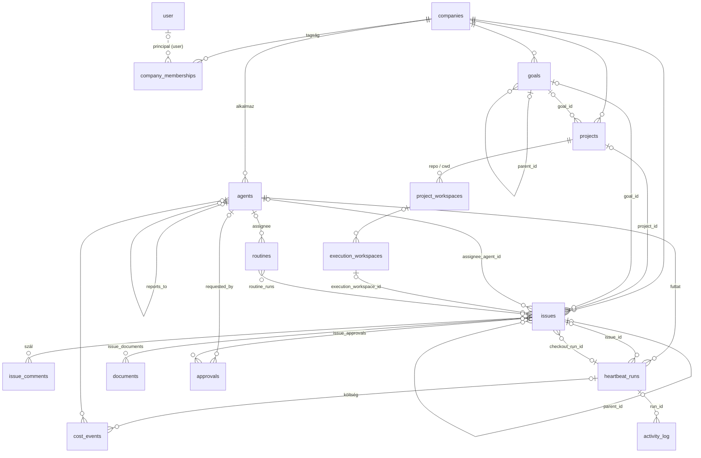

**Egy mondatban:** a *company* (AI-ágens cég) *agent*-eket alkalmaz, akik *goal*-okhoz és
*project*-ekhez kötött *issue*-kat (feladatokat) dolgoznak fel *heartbeat run*-okban, egy
*execution workspace*-ben; minden futás *cost event*-eket és *activity log* bejegyzéseket
termel, a kormányzott lépésekhez *approval* kell, az ismétlődő munkát *routine*-ok indítják.

## 4. Domain-szeletek

### 4.1 Tenant, identitás, hozzáférés

A `companies` a tenant gyökere. Az emberek a Better Auth `user` táblában élnek; a cégtagság
polimorf (`company_memberships`), így ember és ágens is lehet tag. Az ágensek bearer API
kulccsal (`agent_api_keys`, hash-elve), az operátorok board kulccsal vagy sessionnel
azonosítanak. Új tagok meghívón (`invites`) és csatlakozási kérelmen (`join_requests`) át
érkeznek; a kérelem jóváhagyása ágenst is létrehozhat.

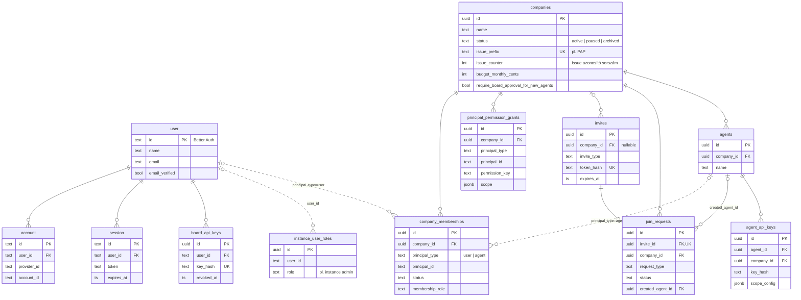

További táblák: `cli_auth_challenges`, `issue_access_grants`, `project_memberships`,
`project_access_members`, `document_memberships`, `run_identity_contexts`,
`agent_identity_keys`, felhasználói preferenciák (`*_preferences`, `inbox_dismissals`).

### 4.2 Ágensek

Az `agents` a második legfontosabb tábla. Egy ágensnek van szerepe, adaptere
(`adapter_type` + `adapter_config`, pl. Claude/Codex), saját havi költségkerete és
életciklus-állapota. A szervezeti fát a `reports_to` önhivatkozás adja. A konfiguráció- és
instrukcióváltozások revíziós táblákba kerülnek (auditálható, visszaállítható). A futás
közötti állapot (session, tokenösszesítők) az `agent_runtime_state`-ben, a feladatonkénti
adapter-session az `agent_task_sessions`-ben él. A felébresztési kérések
(`agent_wakeup_requests`) idempotens kulccsal sorba állnak, és `heartbeat_runs`-t indítanak.

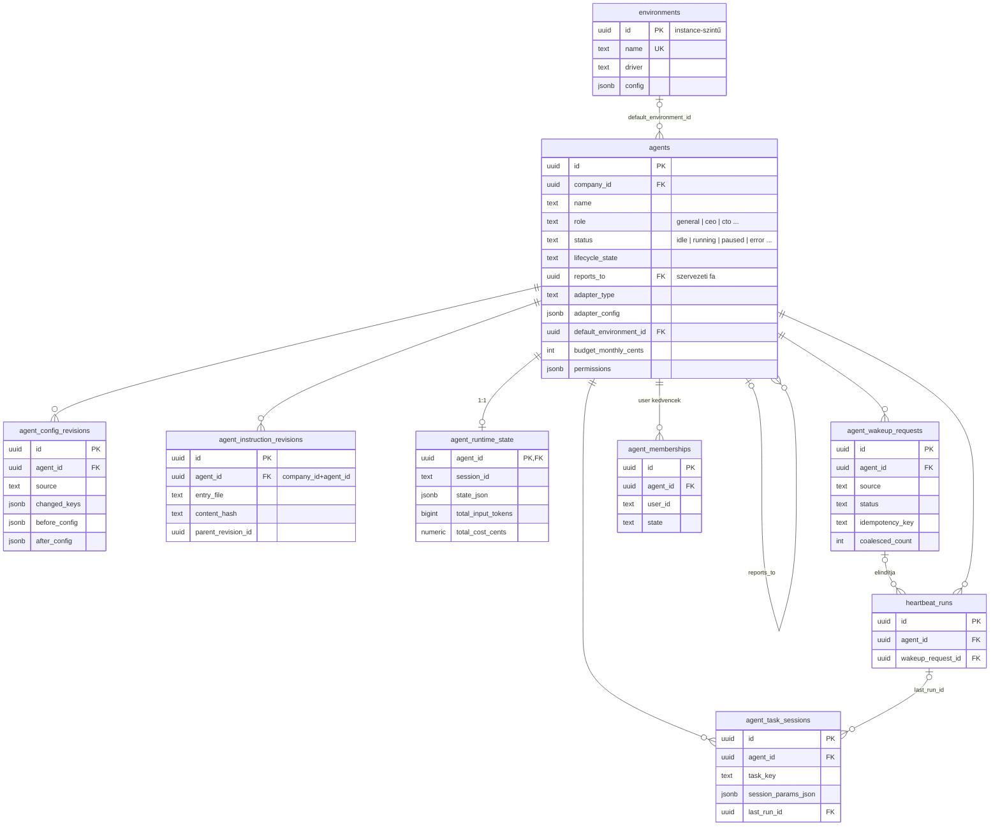

További táblák: `agent_instruction_heads`, `agent_instruction_working_copies`,
`agent_session_goal_actions`, `agent_commentary`, `managed_agent_profiles`,
`remote_agent_profiles`, `adapter_auth_sessions`, külső runnerek
(`muse_runner.ts`, `dot_runner.ts`, `grok_bot.ts`).

### 4.3 Munkaszervezés (célok, projektek, feladatok)

A munka hierarchiája: **goal → project → issue**. A célok fát alkotnak (`level`:
company / team / agent / task). A projekt opcionálisan egy célhoz tartozik, és több célhoz is
köthető (`project_goals`). A projekt munkaterületei (`project_workspaces`) a repo/cwd
forrást írják le. Az `issues` a rendszer munkaegysége: **egyetlen felelőse** van (ágens
*vagy* ember), atomikus checkout-tal (`checkout_run_id`, `execution_locked_at`) zárolható,
és szülő-gyerek fát alkot. Körülötte kommentek, címkék, relációk (pl. blokkolás),
mellékletek és munkatermékek (PR, branch, preview URL, artefakt) csoportosulnak.

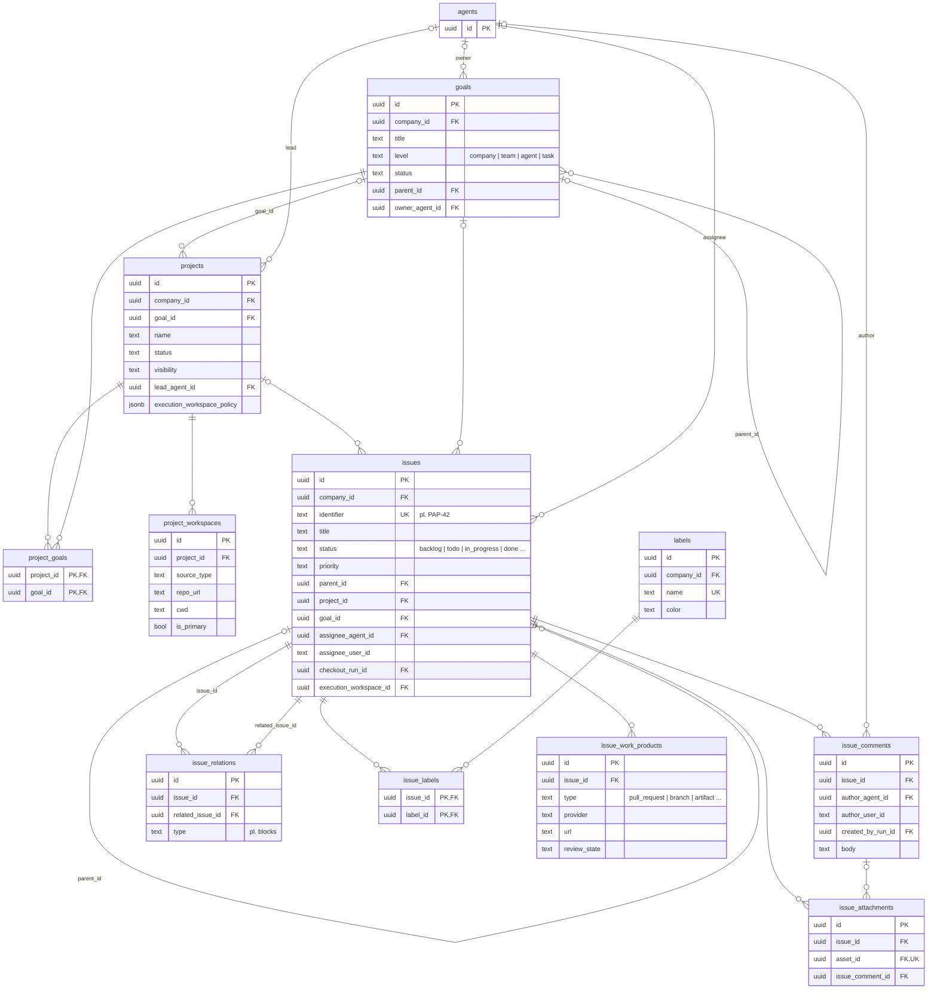

További táblák: `issue_thread_interactions` (strukturált kérdés-válasz a szálban), az
`issue_*` család többi tagja (watchdogok, tree hold-ok, read state, recovery), `cases`
(ügykezelés), `pipelines` / `pipeline_*`, `workflows`, `folders`, `feedback_*`.

### 4.4 Végrehajtás (heartbeat runok és munkaterületek)

Az ágens nem folyamatosan fut: **heartbeat**-ekben ébred. Egy `agent_wakeup_requests` sor
egy `heartbeat_runs` sort indít (a futás állapota, kimenet, költség-elszámolás állapota,
újrapróbálás `retry_of_run_id`-val). A futás részletes eseménynaplója a
`heartbeat_run_events` (a „run log”, csak a helyi DB-ben). A kód egy
`execution_workspaces`-ben fut (projekt-munkaterületből származtatott git ág / cwd), amit
`environment_leases` köt egy futtatókörnyezethez. A munkaterületen futó parancsok
(`workspace_operations`) és szolgáltatások (`workspace_runtime_services`) külön táblában
naplózódnak.

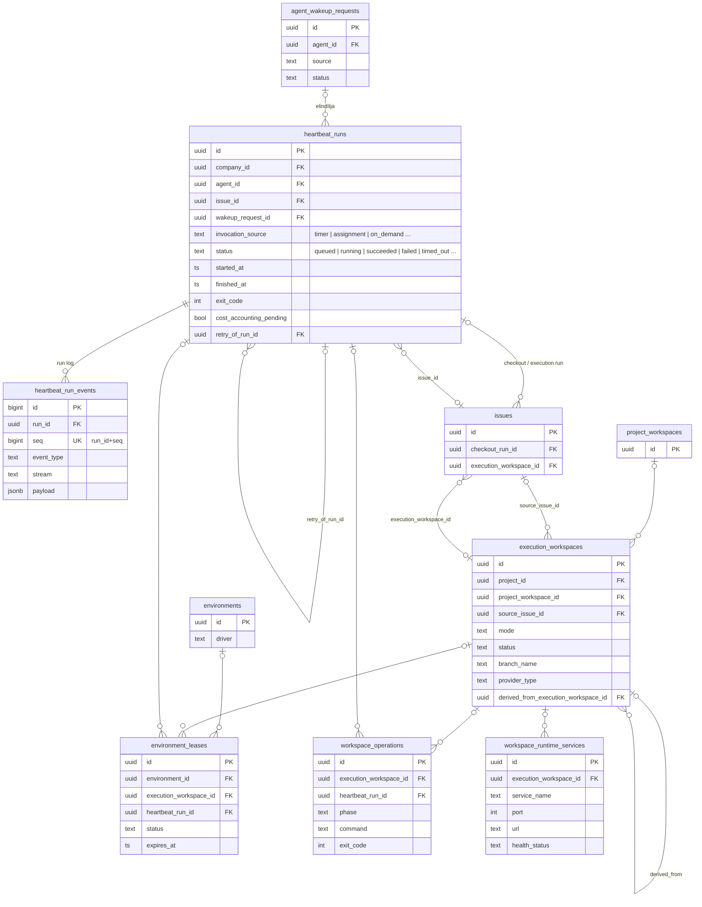

További táblák: `heartbeat_run_watchdog_decisions`, `execution_workspace_*` (repók, hozzáférés,
restore pointok, runtime leasek), `environment_custom_image_*`, `native_run_results`,
`provider_trace_records`, `runner_api_response_reservations`, `browser_use_*`, `smoke_*`,
`resource_lifecycle_events`.

### 4.5 Governance és költség

Három kontrollsík invariáns él itt (`AGENTS.md` 5.3): **jóváhagyási kapu**, **költségkeret
hard-stop** és **activity log**. Az `approvals` egy általános jóváhagyási kérelem
(`type` + `payload`), ami issue-khoz köthető. A `budget_policies` polimorf hatókörre
(`scope_type` + `scope_id`: cég / ágens / projekt) határoz meg ablakos limitet; túllépéskor
`budget_incidents` keletkezik, ami jóváhagyást kérhet. Minden LLM-hívás `cost_events` sort
termel (token, modell, cent), a pénzügyi könyvelés a `finance_events`-ben részletesebb.
Minden mutáló művelet az `activity_log`-ba kerül.

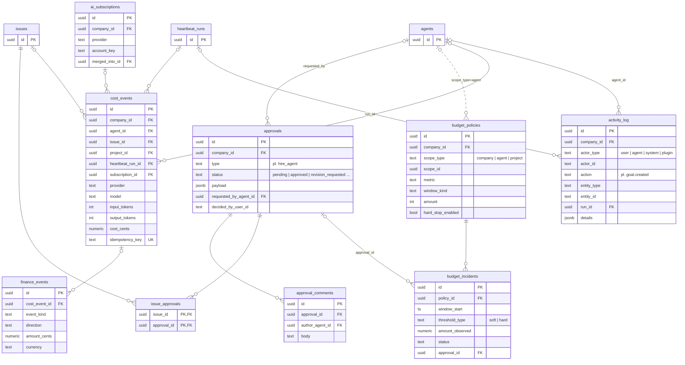

További táblák: `accounting.ts` (számlák, budget reservation, run usage receiptek),
`ai_subscription_prices`, `ai_subscription_connections`.

### 4.6 Dokumentumok és tudás

A `documents` cégszintű, verziózott markdown dokumentum (a legfrissebb tartalom
denormalizálva a `latest_body`-ban, a története a `document_revisions`-ben). A dokumentum
kulcs alapján csatolódik issue-hoz (`issue_documents`, pl. `plan`) vagy routine-hoz
(`routine_documents`); egy dokumentum pontosan egy tulajdonoshoz tartozik (`document_id` UK
a kapcsolótáblán). Szövegrészletekhez annotációs szálak és kommentek kapcsolódnak. A
bináris fájlok az `assets` táblában (objektumtár kulcs + sha256) vannak.

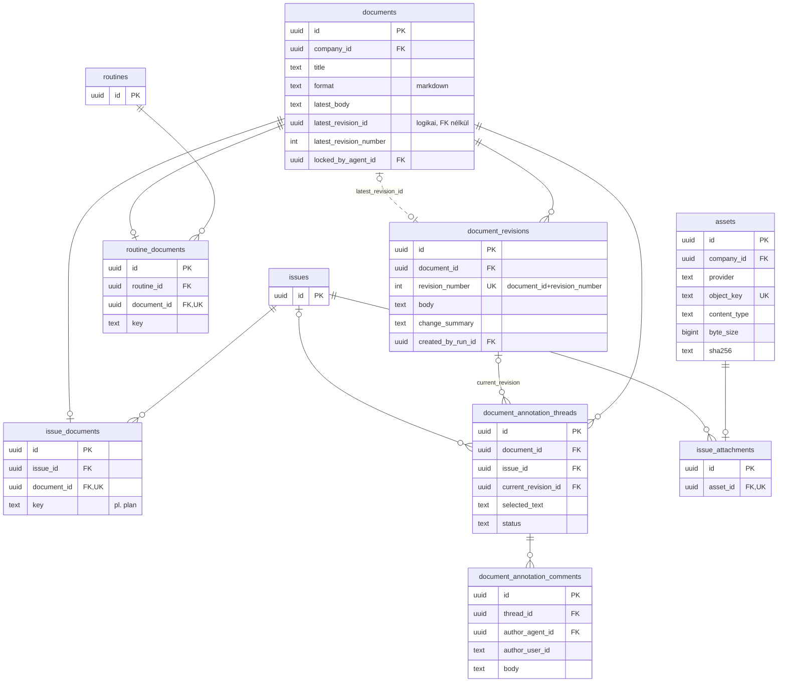

További táblák: `document_annotation_anchor_snapshots`, `document_memberships`,
`company_logos`, `summary_slots`, `status_cards` / `status_card_updates`.

### 4.7 Automatizálás és döntések

**Routine-ok.** Egy `routines` sor ismétlődő munkát ír le (kinek, melyik projektben,
milyen konkurencia- és pótlási szabállyal). Indítói a `routine_triggers` (schedule/cron, webhook, api –
a webhook titokkal aláírva), minden indítás egy `routine_runs` sor, ami issue-t hoz létre
(`linked_issue_id`). A routine definíciója verziózott (`routine_revisions`).

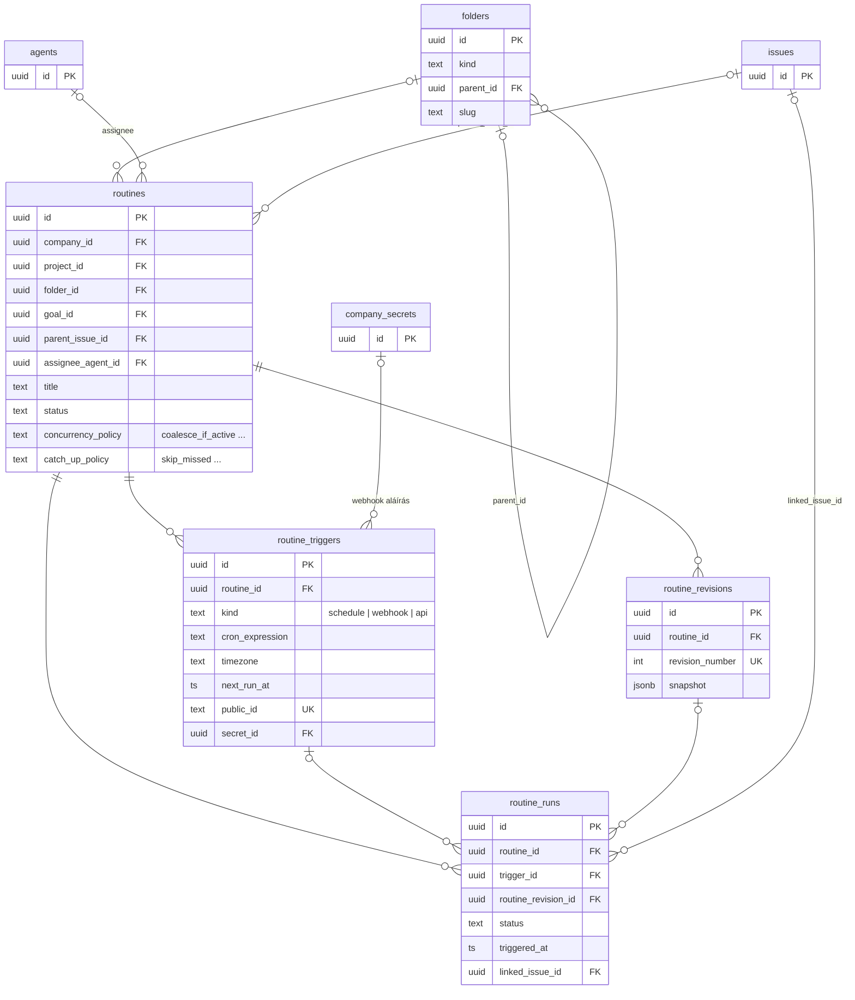

**Döntések és státusz-arbitráció.** Ágens által kért emberi döntés: `decisions` (opciók,
lejárat, aláírt specifikáció), csomagolva `decision_bundles`-be, több cél-issue-val. Külön
lánc dönti el, hogy egy natív futás után az issue státusza változhat-e:
`completion_contracts` (mit jelent a „kész”) → `native_run_results` (a futás eredménye) →
`work_assessments` (értékelés) → `status_decisions` (státuszátmenet) →
`status_decision_effects` (kiszállítandó mellékhatások). Ezek a táblák tenant-biztos
összetett FK-kkal (`company_id + issue_id + …`) kapcsolódnak.

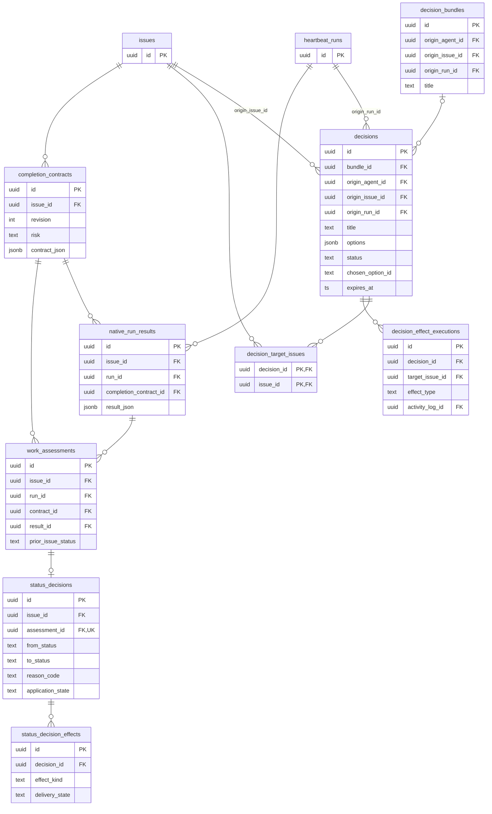

További táblák: `decision_queues` / `decision_queue_items` / `decision_triage*`,
`company_decision_models`, `decision_invocations`, `decision_training_examples`,
`native_run_finalizations`, `fast_responses.ts`, `prompt_injection_prevention.ts`.

### 4.8 Integrációk és bővíthetőség

**Pluginek és eszköz-kapcsolatok.** A `plugins` **instance-szintű** telepítés; cégenként a
`plugin_config` konfigurálja. Az ágensek külső eszközökhöz (MCP, OAuth app, API) a
`tool_applications` → `tool_connections` → `connection_grants` láncon jutnak (alkalmazás →
konkrét kapcsolat hitelesítéssel → kinek szabad használni). Az MCP gatewayek egy
`tool_profiles` szerint szűrik az elérhető eszközöket; minden hívás `tool_invocations` sor.

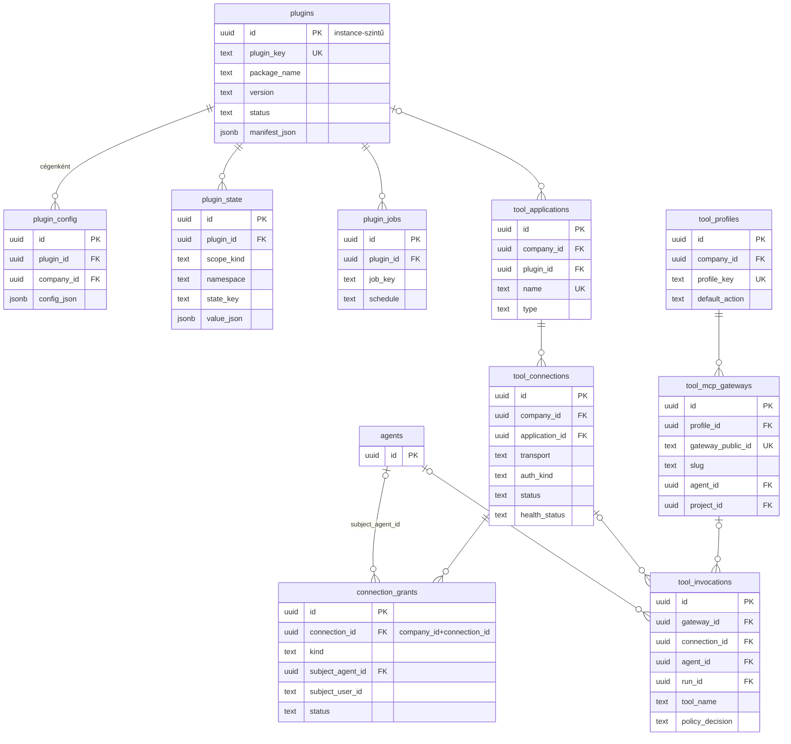

**Titkok, skillek, chat csatornák.** A `company_secrets` verziózott titkokat tárol
(`company_secret_versions`), amelyeket a `company_secret_bindings` köt polimorf célpontokhoz
(`target_type` + `target_id` + `config_path`, pl. egy ágens adapter-konfigjának egy mezője).
A `company_skills` a cég saját skill-katalógusa, verziókkal. A chat csatornák
(`chat_endpoints`: Slack, Teams, Telegram, e-mail, hang) egy-egy ágenshez rendelt botok;
a beszélgetések (`chat_conversations`) mindig egy issue-hoz kötődnek.

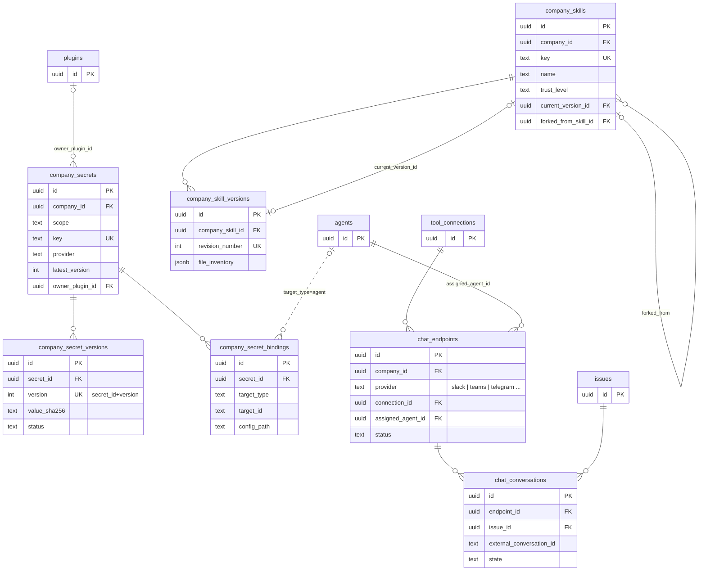

További táblák: a `plugin_*` és `tool_*` család többi tagja, `connection_*`,
`ai_connection_*`, `public_mcp.ts` (`mcp_oauth_*`, `mcp_event_*`), `external_objects`,
`company_secret_proposals`, `company_secret_provider_configs`, `user_secret_*`,
`secret_access_events`, `company_skill_*`, `chat_*`, `email.ts`, `company_observability`.

## 5. Rétegek és adatfolyam (Clean Architecture nézet)

A függőségek iránya kifelé mutat a sémától: a `packages/db` nem ismeri a szervert, a
`packages/shared` nem ismeri az adatbázist, a route nem ír közvetlenül SQL-t.

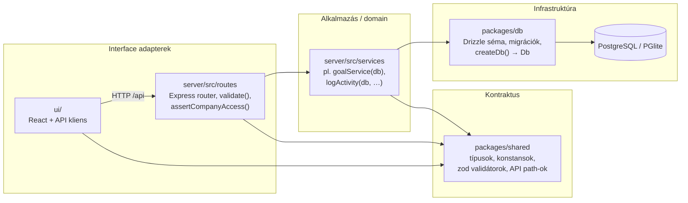

Példa egy útvonalra (`server/src/routes/goals.ts` → `server/src/services/goals.ts`):

1. `POST /api/companies/:companyId/goals` – a route `validate(createGoalSchema)`-val
   (`@paperclipai/shared`) ellenőrzi a bemenetet.
2. `assertCompanyAccess(req, companyId)` – a tenant-határ a route rétegben érvényesül.
3. `goalService(db).create(...)` – a domain-logika a service-ben, Drizzle lekérdezéssel
   (`db.select().from(goals).where(eq(goals.companyId, …))`).
4. `logActivity(db, { action: "goal.created", entityType: "goal", … })` – a mutáció
   `activity_log` sort kap.

SOLID-szempontból: a service-ek konstruktor-injekcióval kapják a `Db`-t (DIP, tesztelhető),
egy service egy aggregátumért felel (SRP), a kontraktus (`shared`) a rétegek közötti stabil
interfész (ISP).

### Egy heartbeat útja az adatbázisban

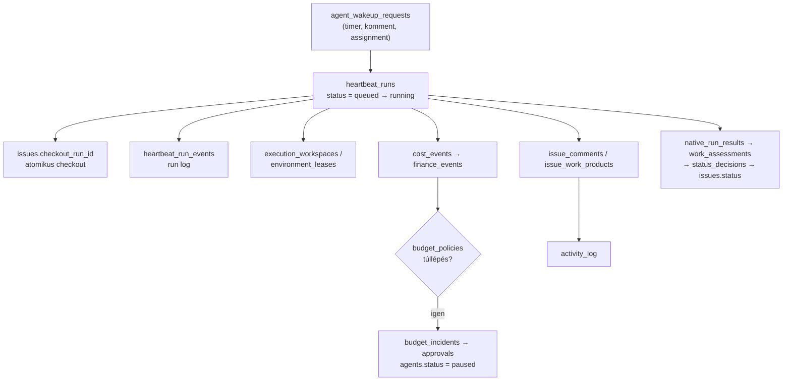

## 6. Megfigyelések (tanulási pontok)

1. **Két gravitációs központ.** A `companies` (tenant) és az `agents` (aktor) szinte minden
   táblához kapcsolódik; az `issues` és a `heartbeat_runs` a munka- és végrehajtási tengely.
   Ha egy új táblát értelmezel, először azt nézd meg, ezek közül melyikhez köt.
2. **Az emberi felhasználó „puha” hivatkozás.** A `*_user_id` oszlopok többnyire `text`
   FK nélkül – a felhasználói azonosság a Better Auth-ban él, a domain csak hivatkozik rá.
3. **Polimorfizmus az adatbázisban.** `principal_type/principal_id`, `scope_type/scope_id`,
   `target_type/target_id`, `actor_type/actor_id`: rugalmas, de az integritást a service
   rétegnek kell biztosítania.
4. **Tenant-biztonság a sémában is.** Az összetett `(company_id, id)` FK-k a
   kódszintű `assertCompanyAccess` mellett második védelmi vonalat adnak.
5. **Denormalizált „legfrissebb” mezők.** `documents.latest_body`,
   `routines.latest_revision_id`, `company_skills.current_version_id`: olvasási
   teljesítményért a fejrekord tárolja az aktuális állapotot, a történet revíziós táblában van.
6. **Sok állapot `jsonb`-ben.** `adapter_config`, `execution_policy`, `execution_state`,
   `payload`: a struktúrát a `packages/shared` típusai írják le, nem az adatbázis.

## 7. Hogyan tartsd naprakészen

- Új tábla: `packages/db/src/schema/*.ts` + export a `packages/db/src/schema/index.ts`-ben,
  majd `pnpm db:generate` (lásd `doc/DATABASE.md`, `AGENTS.md` 6.).
- A diagramokba csak akkor vegyél fel új entitást, ha a működést hordozza; egyébként elég a
  lenti indexben a megfelelő domainhez sorolni.
- Üzemeltetési részletek (PGlite, Postgres, migrációk, backup): `doc/DATABASE.md`.

## 8. Teljes táblaindex domainenként

Mind a 173 sémafájl (és bennük a 301 tábla) besorolva. A `chat_telegram_draft_ids.ts`
tábla helyett egy Postgres sequence-et definiál.

### 1. Tenant, identitás, hozzáférés

| Sémafájl | Táblák |
|---|---|
| `agent_api_keys.ts` | `agent_api_keys` |
| `agent_identity_keys.ts` | `agent_identity_keys` |
| `announcement_dismissals.ts` | `announcement_publications`, `announcement_dismissals` |
| `auth.ts` | `user`, `session`, `account`, `verification` |
| `board_api_keys.ts` | `board_api_keys` |
| `cli_auth_challenges.ts` | `cli_auth_challenges` |
| `companies.ts` | `companies` |
| `company_logos.ts` | `company_logos` |
| `company_memberships.ts` | `company_memberships` |
| `company_onboarding_seeds.ts` | `company_onboarding_seeds` |
| `company_transfer_runs.ts` | `company_transfer_runs` |
| `company_user_sidebar_preferences.ts` | `company_user_sidebar_preferences` |
| `document_memberships.ts` | `document_memberships` |
| `inbox_dismissals.ts` | `inbox_dismissals` |
| `instance_settings.ts` | `instance_settings` |
| `instance_user_roles.ts` | `instance_user_roles` |
| `invites.ts` | `invites` |
| `issue_access_grants.ts` | `issue_access_grants` |
| `join_requests.ts` | `join_requests` |
| `principal_permission_grants.ts` | `principal_permission_grants` |
| `project_access_members.ts` | `project_access_members` |
| `project_memberships.ts` | `project_memberships` |
| `run_identity_contexts.ts` | `run_identity_contexts` |
| `user_company_preferences.ts` | `user_company_preferences` |
| `user_inbox_agent_policies.ts` | `user_inbox_agent_policies` |
| `user_sidebar_preferences.ts` | `user_sidebar_preferences` |

### 2. Ágensek

| Sémafájl | Táblák |
|---|---|
| `adapter_auth_sessions.ts` | `adapter_auth_sessions` |
| `agent_commentary.ts` | `agent_commentary` |
| `agent_config_revisions.ts` | `agent_config_revisions` |
| `agent_instruction_revisions.ts` | `agent_instruction_revisions`, `agent_instruction_heads`, `agent_instruction_working_copies` |
| `agent_memberships.ts` | `agent_memberships` |
| `agent_runtime_state.ts` | `agent_runtime_state` |
| `agent_task_sessions.ts` | `agent_task_sessions`, `agent_session_goal_actions` |
| `agent_wakeup_requests.ts` | `agent_wakeup_requests` |
| `agents.ts` | `agents` |
| `built_in_managed_resources.ts` | `built_in_managed_resources` |
| `dot_runner.ts` | `dot_agent_bindings`, `dot_runner_assignments`, `dot_runner_operations`, `dot_mailbox_items` |
| `grok_bot.ts` | `grok_bot_routines`, `grok_bot_dispatches` |
| `managed_agent_profiles.ts` | `managed_agent_profiles` |
| `muse_runner.ts` | `muse_agent_bindings`, `muse_credentials`, `muse_runner_assignments`, `muse_runner_operations`, `muse_mailbox_items`, `muse_input_deliveries`, `external_agent_holds`, `muse_idle_receipts`, `muse_receiver_contact_buckets` |
| `remote_agent_profiles.ts` | `remote_agent_profiles` |

### 3. Munkaszervezés

| Sémafájl | Táblák |
|---|---|
| `cases.ts` | `cases`, `case_issue_links`, `case_events`, `case_documents`, `case_labels`, `case_attachments`, `case_access_sources`, `case_handoffs` |
| `feedback_exports.ts` | `feedback_exports` |
| `feedback_votes.ts` | `feedback_votes` |
| `folders.ts` | `folders` |
| `goals.ts` | `goals` |
| `issue_approvals.ts` | `issue_approvals` |
| `issue_attachments.ts` | `issue_attachments` |
| `issue_comments.ts` | `issue_comments` |
| `issue_create_idempotency_keys.ts` | `issue_create_idempotency_keys` |
| `issue_documents.ts` | `issue_documents` |
| `issue_execution_decisions.ts` | `issue_execution_decisions` |
| `issue_inbox_archives.ts` | `issue_inbox_archives` |
| `issue_labels.ts` | `issue_labels` |
| `issue_plan_decompositions.ts` | `issue_plan_decompositions` |
| `issue_question_response_deliveries.ts` | `issue_question_response_deliveries` |
| `issue_read_states.ts` | `issue_read_states` |
| `issue_recovery_actions.ts` | `issue_recovery_actions` |
| `issue_reference_mentions.ts` | `issue_reference_mentions` |
| `issue_relations.ts` | `issue_relations` |
| `issue_thread_interactions.ts` | `issue_thread_interactions` |
| `issue_tree_hold_members.ts` | `issue_tree_hold_members` |
| `issue_tree_holds.ts` | `issue_tree_holds` |
| `issue_watchdogs.ts` | `issue_watchdogs` |
| `issue_work_products.ts` | `issue_work_products` |
| `issues.ts` | `issues` |
| `labels.ts` | `labels` |
| `pipeline_case_events.ts` | `pipeline_case_events` |
| `pipeline_cases.ts` | `pipeline_cases`, `pipeline_case_issue_links`, `pipeline_case_blockers`, `pipeline_documents`, `pipeline_case_documents`, `pipeline_automation_executions` |
| `pipelines.ts` | `pipelines`, `pipeline_stages`, `pipeline_transitions` |
| `project_goals.ts` | `project_goals` |
| `project_workspaces.ts` | `project_workspaces` |
| `projects.ts` | `projects` |
| `workflows.ts` | `workflows` |

### 4. Végrehajtás

| Sémafájl | Táblák |
|---|---|
| `browser_use.ts` | `browser_use_settings`, `browser_use_sessions`, `browser_use_runs`, `browser_use_browsers` |
| `environment_custom_image_setup_sessions.ts` | `environment_custom_image_setup_sessions` |
| `environment_custom_image_templates.ts` | `environment_custom_image_templates` |
| `environment_leases.ts` | `environment_leases` |
| `environments.ts` | `environments` |
| `execution_workspace_repositories.ts` | `execution_workspace_repositories` |
| `execution_workspace_repository_access.ts` | `execution_workspace_repository_access` |
| `execution_workspace_repository_roots.ts` | `execution_workspace_repository_roots` |
| `execution_workspace_restore_points.ts` | `execution_workspace_restore_points` |
| `execution_workspace_runtime_leases.ts` | `execution_workspace_runtime_leases` |
| `execution_workspaces.ts` | `execution_workspaces` |
| `heartbeat_run_events.ts` | `heartbeat_run_events` |
| `heartbeat_run_watchdog_decisions.ts` | `heartbeat_run_watchdog_decisions` |
| `heartbeat_runs.ts` | `heartbeat_runs` |
| `native_run_results.ts` | `native_run_results` |
| `provider_trace_records.ts` | `provider_trace_records` |
| `resource_lifecycle_events.ts` | `resource_lifecycle_events` |
| `runner_api_response_reservations.ts` | `runner_api_response_reservations` |
| `smoke_lab.ts` | `smoke_runs`, `smoke_run_steps` |
| `workspace_operations.ts` | `workspace_operations` |
| `workspace_runtime_services.ts` | `workspace_runtime_services` |

### 5. Governance és költség

| Sémafájl | Táblák |
|---|---|
| `accounting.ts` | `provider_billing_snapshots`, `run_usage_receipts`, `accounting_runtime_baselines`, `budget_reservations`, `billing_invoices`, `billing_invoice_lines`, `cost_adjustments` |
| `activity_log.ts` | `activity_log` |
| `ai_subscriptions.ts` | `ai_subscriptions`, `ai_subscription_prices`, `ai_subscription_connections` |
| `approval_comments.ts` | `approval_comments` |
| `approvals.ts` | `approvals` |
| `budget_incidents.ts` | `budget_incidents` |
| `budget_policies.ts` | `budget_policies` |
| `cost_events.ts` | `cost_events` |
| `finance_events.ts` | `finance_events` |

### 6. Dokumentumok és tudás

| Sémafájl | Táblák |
|---|---|
| `assets.ts` | `assets` |
| `document_annotation_anchor_snapshots.ts` | `document_annotation_anchor_snapshots` |
| `document_annotation_comments.ts` | `document_annotation_comments` |
| `document_annotation_threads.ts` | `document_annotation_threads` |
| `document_revisions.ts` | `document_revisions` |
| `documents.ts` | `documents` |
| `status_cards.ts` | `status_cards`, `status_card_updates` |
| `summary_slots.ts` | `summary_slots` |

### 7. Automatizálás és döntések

| Sémafájl | Táblák |
|---|---|
| `completion_contracts.ts` | `completion_contracts` |
| `decision_models.ts` | `company_decision_models`, `decision_invocations` |
| `decision_queues.ts` | `decision_queues`, `decision_queue_items`, `decision_triage`, `decision_triage_events`, `decision_retention`, `decision_archive_notification_outbox` |
| `decision_training_examples.ts` | `decision_training_examples` |
| `decisions.ts` | `decision_bundles`, `decisions`, `decision_target_issues`, `decision_effect_executions` |
| `fast_responses.ts` | `company_fast_responses`, `fast_response_requests` |
| `native_run_finalizations.ts` | `native_run_finalizations` |
| `prompt_injection_prevention.ts` | `company_prompt_injection_prevention`, `prompt_injection_invocations` |
| `routine_documents.ts` | `routine_documents` |
| `routines.ts` | `routines`, `routine_revisions`, `routine_triggers`, `routine_runs`, `routine_webhook_test_receipts` |
| `status_decision_effects.ts` | `status_decision_effects` |
| `status_decisions.ts` | `status_decisions` |
| `work_assessments.ts` | `work_assessments` |

### 8. Integrációk és bővíthetőség

| Sémafájl | Táblák |
|---|---|
| `ai_connection_defaults.ts` | `ai_connection_defaults` |
| `ai_connection_routing.ts` | `ai_connection_pools`, `ai_connection_router_cursors`, `ai_connection_task_pins` |
| `ai_provider_defaults.ts` | `ai_provider_defaults` |
| `chat_channels.ts` | `chat_endpoints`, `chat_endpoint_resources`, `chat_external_principals`, `chat_identity_links`, `chat_conversations`, `chat_deliveries`, `chat_publications`, `chat_message_links`, `chat_actions`, `chat_agent_routes`, `chat_endpoint_leases`, `chat_sdk_state` |
| `chat_completion_deliveries.ts` | `chat_task_handoffs`, `chat_completion_deliveries` |
| `chat_discord_command_owners.ts` | `chat_discord_command_owners` |
| `chat_github.ts` | `chat_github_configurations`, `chat_github_registrations`, `chat_github_reviews` |
| `chat_slack_manager_grants.ts` | `chat_slack_manager_grants` |
| `chat_slack_registrations.ts` | `chat_slack_registrations` |
| `chat_teams_file_transfers.ts` | `chat_teams_file_transfers` |
| `chat_telegram_draft_ids.ts` | _(sequence: chat_telegram_draft_ids)_ |
| `chat_voice_callbacks.ts` | `chat_voice_callbacks` |
| `chat_voice_inbound.ts` | `chat_voice_phone_lines`, `chat_voice_inbound_calls` |
| `chat_voice_reports.ts` | `chat_voice_reports` |
| `chat_voice_sessions.ts` | `chat_voice_sessions`, `chat_voice_tool_calls`, `chat_voice_replies` |
| `company_observability.ts` | `company_observability` |
| `company_secret_bindings.ts` | `company_secret_bindings` |
| `company_secret_proposals.ts` | `company_secret_proposals` |
| `company_secret_provider_configs.ts` | `company_secret_provider_configs` |
| `company_secret_versions.ts` | `company_secret_versions` |
| `company_secrets.ts` | `company_secrets` |
| `company_skill_policies.ts` | `company_skill_policies` |
| `company_skill_sources.ts` | `company_skill_sources`, `project_skill_sources`, `company_skill_source_entries`, `company_skill_import_budgets` |
| `company_skills.ts` | `company_skills`, `company_skill_repository_snapshots`, `company_skill_versions`, `company_skill_stars`, `company_skill_comments`, `company_skill_test_inputs`, `company_skill_test_run_templates`, `company_skill_test_runs` |
| `connection_event_deliveries.ts` | `connection_event_deliveries` |
| `connection_intent_deliveries.ts` | `connection_intent_deliveries` |
| `email.ts` | `email_endpoints`, `email_messages`, `email_sends` |
| `external_object_mentions.ts` | `external_object_mentions` |
| `external_objects.ts` | `external_objects` |
| `plugin_company_settings.ts` | `plugin_company_settings` |
| `plugin_config.ts` | `plugin_config` |
| `plugin_database.ts` | `plugin_database_namespaces`, `plugin_migrations` |
| `plugin_entities.ts` | `plugin_entities` |
| `plugin_jobs.ts` | `plugin_jobs`, `plugin_job_runs` |
| `plugin_lifecycle_acknowledgments.ts` | `plugin_lifecycle_acknowledgments` |
| `plugin_logs.ts` | `plugin_logs` |
| `plugin_managed_resources.ts` | `plugin_managed_resources` |
| `plugin_state.ts` | `plugin_state` |
| `plugin_webhooks.ts` | `plugin_webhook_deliveries` |
| `plugins.ts` | `plugins` |
| `public_mcp.ts` | `mcp_oauth_clients`, `mcp_oauth_metadata_admissions`, `mcp_oauth_grants`, `mcp_oauth_requests`, `mcp_oauth_tokens`, `mcp_oauth_device_requests`, `mcp_mutation_receipts`, `mcp_event_subscriptions`, `mcp_event_admissions`, `mcp_event_deliveries`, `mcp_attachment_uploads`, `mcp_file_tickets` |
| `secret_access_events.ts` | `secret_access_events` |
| `tool_access.ts` | `tool_applications`, `tool_connections`, `connection_grants`, `connection_grant_members`, `connection_grant_delegations`, `tool_connection_installs`, `tool_oauth_states`, `tool_catalog_entries`, `tool_profiles`, `tool_profile_entries`, `tool_profile_bindings`, `tool_mcp_gateways`, `tool_mcp_gateway_tokens`, `tool_policies`, `tool_runtime_slots`, `tool_stdio_command_templates`, `tool_gateway_sessions`, `tool_gateway_rate_limit_counters`, `tool_invocations`, `tool_action_requests`, `tool_call_events`, `connection_token_issuances`, `tool_rate_limit_counters`, `tool_runtime_metric_counters`, `tool_access_audit_events` |
| `tool_action_deliveries.ts` | `tool_action_deliveries` |
| `tool_connection_app_snapshots.ts` | `tool_connection_app_snapshots` |
| `tool_connection_app_syncs.ts` | `tool_connection_app_syncs` |
| `user_secret_declarations.ts` | `user_secret_declarations` |
| `user_secret_definitions.ts` | `user_secret_definitions` |
